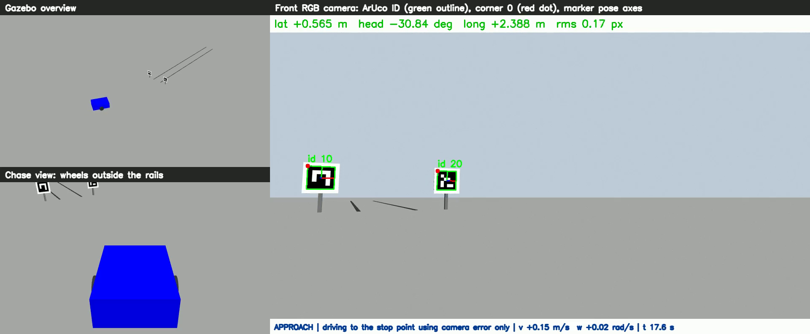
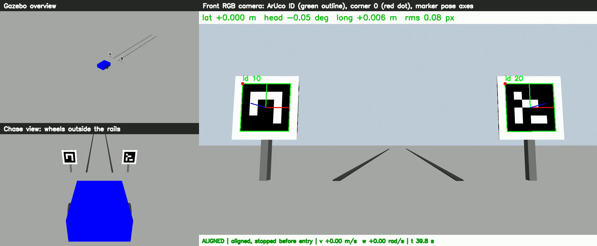
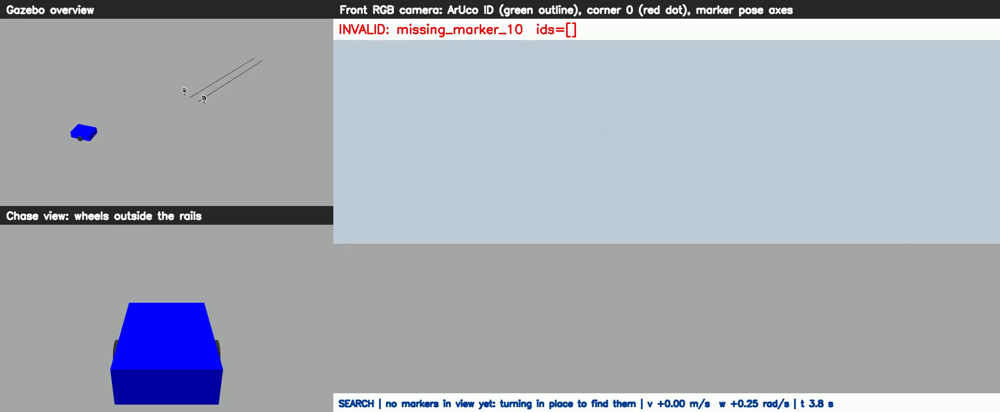
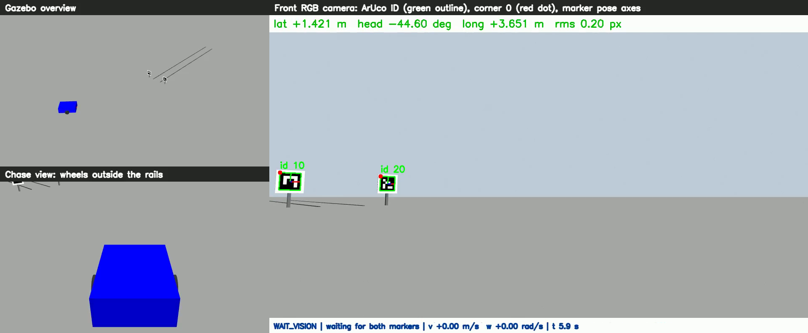
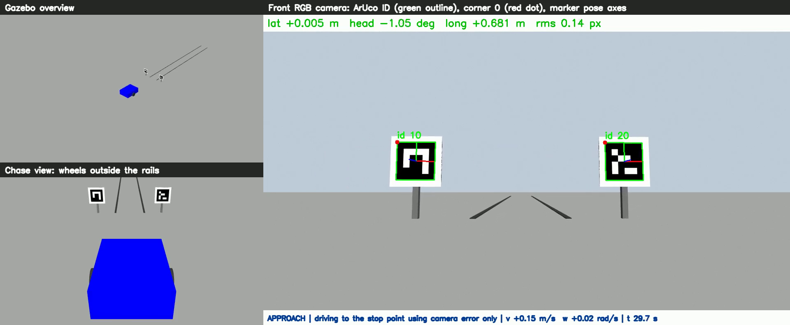
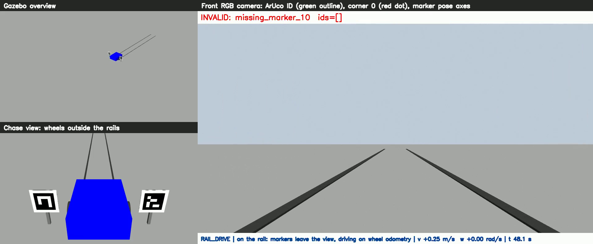
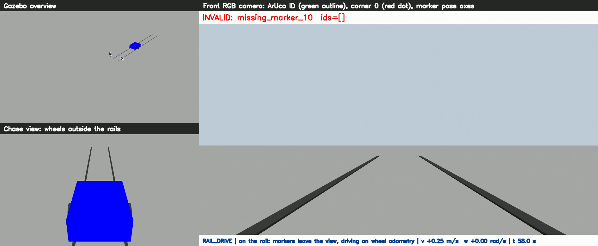
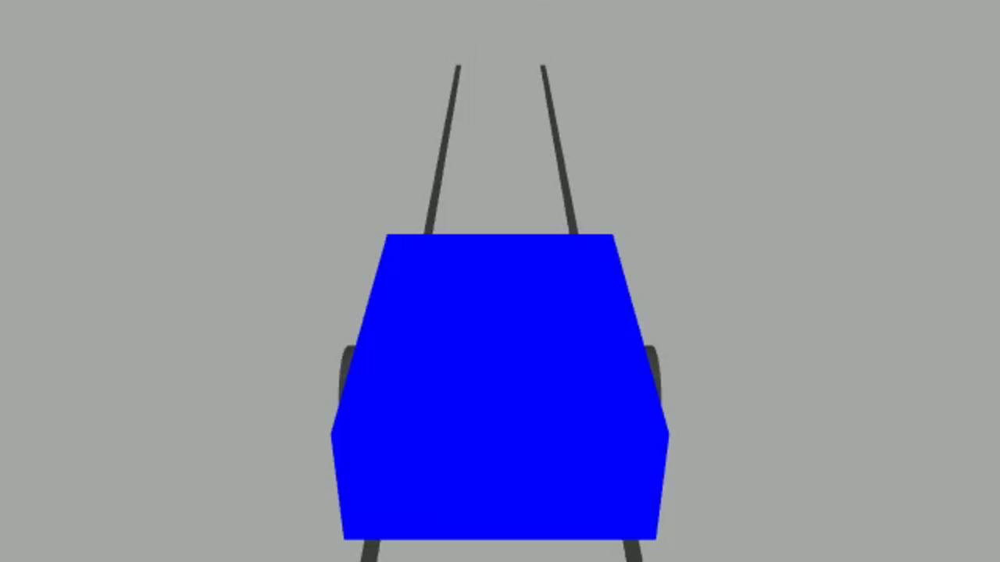

# 스마트팜 2륜 레일카 정렬·진입 데모 총정리

2륜 차동구동 대차가 레일 입구의 ArUco 마커 2개를 RGB 카메라로 읽어 스스로 자세를 맞추고, 레일에 진입해 끝까지 주행하는 시뮬레이션입니다.
ROS 1 Noetic과 Gazebo Classic 11로 구현했으며, **치수는 모두 실측값이 아닌 시뮬레이션 가정값**입니다.

| 마커를 보고 주행 | 레일 앞에 정렬 완료 |
|---|---|
|  |  |

## 1. 한눈에 보기

| 항목 | 내용 |
|---|---|
| 하는 일 | 마커 탐색 → 곡선 접근 → 정지 지점에서 정렬 → 레일 진입 → 레일 끝에서 정지 |
| 차량 구조 | 두 바퀴가 왼쪽 레일 바로 왼쪽, 오른쪽 레일 바로 오른쪽을 지남 |
| 정렬 구간 입력 | 카메라로 계산한 오차만 사용 |
| 레일 구간 입력 | 마지막 카메라 헤딩과 바퀴 엔코더 오도메트리 |
| 정렬 결과 (13회) | 횡방향 2.1 mm 이하, 헤딩 0.14° 이하, 종방향 8.3 mm 이하 (Gazebo 실제 자세 기준) |
| 레일 주행 결과 (13회) | 최대 횡편차 6.9 mm. 바퀴와 레일 사이 여유 40 mm 안에서 유지 |
| 범위 밖 | 실제 차량, 조명 변화, 장애물 감지, 여러 레일 간 이동 |

Gazebo 실제 자세는 결과 검증 도구만 읽습니다. 이 도구들은 제어 노드로 아무것도 보내지 않으므로 실제 자세가 제어에 쓰이지 않습니다.

## 2. 장면으로 보는 동작

아래는 레일 왼쪽 옆, 90° 돌아간 자세에서 출발한 영상(`side_left`)의 장면입니다. 각 사진의 오른쪽은 RGB 카메라 인식 화면, 왼쪽 위는 전경, 왼쪽 아래는 차량 추적 화면입니다.

### 2.1 마커 탐색 (`SEARCH`)

중심선에서 1.5 m 옆, 레일과 수직으로 서 있어 마커가 화각 밖입니다. 빨간 `INVALID`는 마커가 없다는 표시입니다. 제자리 회전으로 마커를 찾습니다.



### 2.2 마커 발견 (`WAIT_VISION`)

두 마커가 동시에 보이면 회전을 멈춥니다. 초록 윤곽이 검출 영역, 빨간 점이 코너 0, 색 축이 마커별 자세이고, 위쪽 띠에 오차가 표시됩니다.



### 2.3 마커를 보고 주행 (`APPROACH`)

횡방향 오차에 따라 정한 각도로 비스듬히 전진합니다. 중심선에 가까워질수록 각도를 줄입니다.

| 먼 거리 | 가까운 거리 |
|---|---|
|  |  |

### 2.4 정렬 완료 (`ALIGNED`)

입구 1.4 m 앞에 정지합니다. 오차가 기준 안에 1초 동안 머물면 `ALIGNED`입니다. 추적 화면에서 레일이 차체 정면으로 곧게 뻗고, 카메라 화면에서 두 마커가 좌우 대칭입니다.


### 2.5 레일 진입 (`RAIL_DRIVE`)

3초 대기 후 두 마커 사이로 들어갑니다. 곧 마커가 화각을 벗어나며, 레일 구간에서는 이 상태가 정상입니다.



### 2.6 레일 주행과 정지 (`RAIL_END`)

바퀴 엔코더로 거리를 재며 직진합니다. 레일이 차체 아래, 두 바퀴 안쪽을 지나갑니다. 5.5 m를 이동하면 정지합니다.

| 레일 주행 | 바퀴와 레일 확대 |
|---|---|
|  |  |

## 3. 시스템 구조

```
              Gazebo Classic 11 (월드, 대차, 물리, 카메라)
                 │                 │                ▲
 /rail_cam/image_raw        /odom (바퀴 엔코더)      │ /cmd_vel
 /rail_cam/camera_info             │                │
                 ▼                 │                │
      aruco_rail_estimator         │                │
      마커 검출 + 자세 계산          │                │
                 │                 │                │
       /rail_align/errors          ▼                │
                 └──────► alignment_controller ─────┘
                                   │
                          /rail_align/state

 [검증 전용. 제어로 되돌아가는 출력 없음]
 run_recorder       : errors, state, cmd_vel + Gazebo 실제 자세 → CSV, 요약
 video_recorder     : debug_image, 전경 카메라, 추적 카메라 → MP4
 verify_perception  : 차량을 옮겨 오차 부호 확인
 verify_safety      : 마커 가림, 영상 정지 등을 일으켜 정지 확인
```

`demo.launch` 하나가 전체를 실행합니다. 실행 순서는 다음과 같습니다.

1. `config/demo.yaml`을 ROS 파라미터로 올립니다.
2. `generate_world.py`가 같은 설정으로 월드와 마커 텍스처를 `~/.ros/rail_align_demo/`에 생성합니다.
3. `xacro`가 같은 설정으로 대차 URDF를 만듭니다.
4. Gazebo를 실행하고 `spawn_robot.py`가 시작 자세에 대차를 놓습니다.
5. 인식, 제어, 기록 노드가 시작됩니다.

설정이 YAML 한 곳에 있어, 마커 간격이나 카메라 높이를 바꾸면 월드, 차량, 인식, 제어에 함께 반영됩니다.

## 4. 좌표계와 오차 정의

레일 좌표계는 Gazebo 월드 좌표계와 같습니다. 차량 기준점은 차축 중심(`base_link`)입니다.

```
              ■ ID 10  왼쪽 마커 (y = +0.55)
              |
              |======================  왼쪽 레일 (y = +0.25)
 --- 정지점 ---+---------------------> +X (레일 안쪽)
   x = -1.40  |======================  오른쪽 레일 (y = -0.25)
              | 진입선 x = 0
              ■ ID 20  오른쪽 마커 (y = -0.55)
```

| 오차 | 계산 | 양수의 의미 |
|---|---|---|
| 횡방향 | `y` | 중심선 왼쪽에 있음 |
| 헤딩 | `yaw` | 코가 레일 방향보다 왼쪽(반시계)으로 돌아감 |
| 종방향 | `x_정지점 − x` | 정지점이 아직 앞에 있음 |

## 5. 영상 인식 방식

구현은 `src/rail_align_demo/geometry.py`와 `scripts/aruco_rail_estimator.py`에 있습니다.

1. **입력:** `cv_bridge`로 카메라 영상을, `camera_info`로 내부 파라미터를 받습니다.
2. **검출:** `cv2.aruco`로 ID와 코너를 찾고 서브픽셀로 다듬습니다. ID 10과 20이 모두 있어야 합니다.
3. **마커별 자세:** 각 마커를 PnP로 풀어 카메라 기준 위치를 구합니다.
4. **전체 자세:** 두 마커의 코너 8개를 알려진 배치와 맞춰 PnP로 풉니다. 간격이 넓어 마커 하나일 때보다 정밀합니다. 평면 PnP의 해 2개 중 차량이 지면 위에 있는 쪽을 고릅니다.
5. **차량 자세 변환:** `T_rail_base = T_rail_optical · T_optical_base`. 뒤쪽 항은 설정의 카메라 장착값으로 만듭니다.
6. **오차 계산:** 차량 자세를 4장의 세 오차로 바꿔 `/rail_align/errors`로 내보냅니다.

다음 경우는 잘못된 값이 제어로 가지 않도록 프레임을 무효로 처리합니다.

| 무효 조건 | 기본값 |
|---|---|
| 마커 쌍이 다 안 보이거나 같은 ID가 중복됨 | - |
| 마커별 위치로 잰 간격이 설정과 다름 | 15 cm 초과 |
| 마커가 너무 멂 | 5.5 m 초과 |
| 재투영 오차가 큼 | 3 px 초과 |
| 계산된 차축 높이가 비현실적 | 10 cm 초과 차이 |
| 계산된 차체 기울기가 비현실적 | 10° 초과 |

## 6. 제어 방식

구현은 `src/rail_align_demo/controller.py`이며, ROS 없이 단위 테스트할 수 있도록 상태 기계를 분리했습니다. 명령은 `/cmd_vel`의 직진 속도와 각속도만 사용합니다.

```
 WAIT_VISION ⇄ SEARCH
     │
     ▼
 ALIGN_HEADING → APPROACH → FINAL_HEADING → HOLD → ALIGNED → RAIL_DRIVE → RAIL_END
                  ▲    │                     │
                  │    └ 중심에서 벗어나 도착   └ 기준 이탈: 다시 보정
                  └ RETREAT (후진 후 재접근, 최대 3회. 넘기면 FAILED)
```

| 상태 | 동작 |
|---|---|
| `WAIT_VISION` | 유효한 추정이 2초 이어질 때까지 대기 |
| `SEARCH` | 마커를 처음 찾을 때까지 0.25 rad/s로 제자리 회전. 최대 360°. 회전 방향을 지정한 시작 자세에서만 동작 |
| `ALIGN_HEADING` | 제자리 회전으로 목표 헤딩에 맞춤 |
| `APPROACH` | 전진과 선회로 정지점까지 접근 |
| `RETREAT` | 중심에서 벗어난 채 도착하면 후진 후 재시도 |
| `FINAL_HEADING` | 제자리 회전으로 레일 방향에 맞춤 |
| `TRIM_LONGITUDINAL` | 종방향 오차가 남으면 저속으로 미세 조정 |
| `HOLD` | 정지한 채 기준을 1초 연속 유지하는지 확인 |
| `ALIGNED` | `ALIGNED` 출력 후 3초 정지 |
| `RAIL_DRIVE` | 레일 진입 후 직진 |
| `RAIL_END` | 정지 유지 |
| `SAFETY_STOP` | 영상이나 마커를 잃으면 속도 0. 복구되면 이전 상태로 복귀 |

**접근 제어 식**

```
목표 헤딩 = -clip( atan(3.0 × 횡방향 오차), ±각도 제한 )
각속도   = clip( 1.5 × (목표 헤딩 − 헤딩), ±0.40 rad/s )
직진 속도 = clip( 0.5 × 종방향 오차, 0.03 ~ 0.15 m/s ) × cos(헤딩 차이)
```

2륜 차량은 옆으로 움직일 수 없으므로, 중심선을 향해 비스듬히 전진하며 횡방향 오차를 줄입니다. 각도 제한은 고정값이 아니라 **두 마커가 화각 안에 남는 최대 각도**를 차량 위치에서 계산하며, 15~40° 범위로 묶습니다. 멀리서는 크게 꺾고 가까이서는 작게 꺾는 이유입니다.

**성공 기준 (설정 가능)**

| 항목 | 기준 |
|---|---|
| 횡방향 오차 | 3 cm 이하 |
| 헤딩 오차 | 3° 이하 |
| 종방향 오차 | 5 cm 이하 |
| 유지 시간 | 1초 연속 |

## 7. 레일 주행 방식

입구를 지나면 마커가 화각 밖으로 나가므로 카메라로 위치를 잴 수 없습니다. 그래서 다음과 같이 주행합니다.

1. 출발 직전 카메라 헤딩으로 "오도메트리 좌표계에서 레일 방향"을 계산합니다.
2. 바퀴 엔코더 오도메트리(`/odom`)로 그 방향을 유지하며 직진합니다.
3. 이동 거리가 5.5 m가 되면 정지합니다. 최고 속도는 0.25 m/s이고, 끝에서 감속합니다.

**한계:** 레일은 시각 모델이라 차량을 물리적으로 안내하지 않고, 출발 후에는 레일 대비 위치를 보정하지 않습니다. 실제 차량은 바퀴 미끄러짐이 누적되므로 레일 가이드나 추가 센서가 필요합니다.

## 8. 안전 정지

| 조건 | 첫 검출 전 | 정렬 구간 | 레일 구간 |
|---|---|---|---|
| 마커 쌍 없음 또는 소실 (0.3초) | 정지. 방향을 지정한 시작 자세만 탐색 회전 | 정지 | 정상이므로 계속 주행 |
| 영상 끊김 (0.5초) | 정지 | 정지 | 정지 |
| `/odom` 끊김 (0.5초) | 영향 없음 | 영향 없음 | 정지 |

- **벽시계 감시:** 감시 루프는 실제 시간 기준이라 시뮬레이션 시계가 멈춰도 0 명령을 계속 보냅니다.
- **탐색의 예외:** `SEARCH`는 "마커가 없으면 정지" 규칙의 유일한 예외입니다. 첫 검출 전에만, 영상이 들어올 때만, 360° 안에서만 회전합니다.

## 9. 검증 결과

오차는 Gazebo 실제 자세 기준입니다. 전체 표는 [results/scenarios.md](../results/scenarios.md)에 있습니다.

### 시나리오 13회: 모두 성공

| 시작 자세 | 횟수 | 정렬 시간 | 정렬 후 최대 오차 (횡방향 / 헤딩 / 종방향) | 레일 최대 횡편차 |
|---|---|---|---|---|
| `left`: 왼쪽 0.30 m, +12° | 3 | 16.5~16.6 s | 2.1 mm / 0.13° / 8.3 mm | 5.6 mm |
| `right`: 오른쪽 0.25 m, +15° | 3 | 15.3 s | 1.8 mm / 0.06° / 7.5 mm | 4.5 mm |
| `left_inward`: 왼쪽 0.20 m, -15° | 1 | 13.7 s | 1.9 mm / 0.10° / 8.0 mm | 3.5 mm |
| `right_outward`: 오른쪽 0.30 m, -12° | 1 | 16.7 s | 1.4 mm / 0.01° / 7.1 mm | 2.1 mm |
| `side_left`: 왼쪽 1.50 m, -90° | 2 | 36.0~36.1 s | 1.7 mm / 0.07° / 6.2 mm | 4.1 mm |
| `side_right`: 오른쪽 1.50 m, +90° | 2 | 36.1~36.2 s | 1.9 mm / 0.10° / 7.2 mm | 2.5 mm |
| `custom`: 왼쪽 0.15 m, -20° | 1 | 12.1 s | 2.1 mm / 0.14° / 7.4 mm | 6.9 mm |

### 카메라 추정과 실제 자세의 차이

| 구간 | 횡방향 | 헤딩 | 종방향 |
|---|---|---|---|
| 정지점 1 m 이내 (모든 실행 최대) | 9 mm | 0.31° | 9 mm |
| 먼 거리 포함 (`side_*` 최대) | 11.0 cm | 1.44° | 5.3 cm |
| 먼 거리 포함 (그 외 최대) | 1.7 cm | 0.61° | 0.9 cm |

먼 거리에서는 오차가 크지만, 접근하며 줄어들어 최종 정렬에는 문제가 없었습니다.

### 그 외 검증

| 항목 | 결과 |
|---|---|
| 오차 부호 | 10개 자세 모두 통과 (제어 연결 전, 실제 Gazebo 영상) |
| 접근 중 마커 가림 | 0.44초 후 속도 0, 이동 4.8 mm, 해제 후 재개 |
| 접근 중 영상 정지 | 0.30초 후 속도 0, 해제 후 재개 |
| 레일 주행 중 영상과 오도메트리 정지 | 0.49초 후 속도 0, 해제 후 재개 |
| 접근 중 인식 노드 종료 | 0.34초 후 속도 0, 이동 3.3 mm |
| 처음부터 마커 미검출 (`blind`) | 8초 동안 명령 모두 0, 이동 1.3 mm |
| 단위 테스트 22개 | OpenCV 4.13과 4.2 양쪽에서 통과 |
| 다른 설정 파일 (`alt_example.yaml`) | 레일 끝까지 성공 |
| 시스템 OpenCV 4.2로 실행 | 레일 끝까지 성공 |
| 모니터 없이 실행 (`xvfb`) | 레일 끝까지 성공 |
| `rail_drive:=false` | `ALIGNED`에서 정지 유지 |

### 미검증

| 항목 | 이유 |
|---|---|
| 실제 차량과 레일 | 실측 치수와 하드웨어 없음 |
| 조명 변화, 마커 오염, 렌즈 왜곡 | 시뮬레이션이 이상적 조건 |
| `/odom`만 단독으로 끊긴 경우 | 단위 테스트로만 확인 |
| 탐색 각도 초과로 `FAILED` | 단위 테스트로만 확인 |

## 10. 개발 중 찾아 고친 문제

실제로 돌려 보며 발견한 문제입니다. 비슷한 시스템을 실제 차량에 옮길 때 참고할 수 있습니다.

| 증상 | 원인 | 조치 |
|---|---|---|
| 차체 기울기가 89°로 계산됨 | 변환 행렬 합성에서 역행렬 누락 | 수정. 합성 영상 단위 테스트로 발견 |
| 정지 순간 차체가 1° 돌아감 | 시뮬레이터 차동구동 플러그인의 가속 제한 | 플러그인 가속 제한 끄기 |
| 차체를 키우자 접근 중 마커를 잃고 정지 | 접근각이 커서 마커가 화각을 벗어남 | 각도 제한을 화각 기준으로 계산, 궤적 테스트 추가 |
| `ALIGNED` 후 출발하지 않음 | `publishTf` 끄면 `/odom`도 발행되지 않음 | 켜 두고 TF 발행만 끔 |
| 레일 구간에서 바퀴가 레일을 밟음 (횡편차 5.7 cm) | 원통 바퀴와 지면의 시뮬레이터 접촉 문제로 차체가 돌아감 | 바퀴 충돌 형상을 구로 변경 (6.5 mm로 감소). 시뮬레이션 전용 조치 |
| 먼 거리에서 횡방향 1.5 m를 0.89 m로 추정 | 약 5.6 m 이상에서 마커가 작아 PnP가 잘못된 해를 냄 | 5.5 m 초과 시 무효 처리, 시작 위치를 x=-5 m로 조정 |

5.7 cm 문제는 영상만 봐서는 알기 어려웠고, 실제 자세와 비교하는 기록 덕분에 발견했습니다.

## 11. 파일 구성

### 패키지: `src/rail_align_demo/`

| 파일 | 역할 |
|---|---|
| `package.xml`, `CMakeLists.txt`, `setup.py` | catkin 패키지 정의와 빌드 설정 |
| `msg/AlignmentError.msg` | 오차, 검출 ID, 무효 사유, 마커 자세 메시지 |
| `config/demo.yaml` | **모든 설정의 기준.** 마커, 레일, 차량, 카메라, 시작 자세, 기준, 제어 값 |
| `config/alt_example.yaml` | 치수를 바꾼 설정 예시 |
| `launch/demo.launch` | 전체 실행. 시작 자세, GUI, 녹화 등 인자 제공 |
| `urdf/rail_cart.urdf.xacro` | 대차 모델: 차체, 바퀴, 캐스터, 카메라, 구동 플러그인, 녹화용 추적 카메라 |

**핵심 코드**

| 파일 | 역할 |
|---|---|
| `src/rail_align_demo/geometry.py` | ArUco 검출, PnP, 무효 판정, 오차 계산 (ROS 없음) |
| `src/rail_align_demo/controller.py` | 상태 기계와 제어 식 (ROS 없음) |
| `scripts/aruco_rail_estimator.py` | 인식 노드. 영상을 받아 `/rail_align/errors` 발행 |
| `scripts/alignment_controller.py` | 제어 노드. 감시 후 `/cmd_vel` 발행 |

**실행 보조**

| 파일 | 역할 |
|---|---|
| `scripts/generate_world.py` | 설정에서 월드와 마커 텍스처 생성 |
| `scripts/spawn_robot.py` | 지정한 시작 자세에 대차 배치 |

**검증과 기록**

| 파일 | 역할 |
|---|---|
| `scripts/run_recorder.py` | 실행별 CSV, 요약, 시작·정렬·종료 사진 기록. Gazebo 실제 자세와 비교 |
| `scripts/video_recorder.py` | 인식 화면, 전경, 추적 화면을 합친 MP4 저장 |
| `scripts/verify_perception.py` | 차량을 옮겨 가며 오차 부호와 정확도 확인 |
| `scripts/verify_safety.py` | 마커 가림, 영상 정지, 노드 종료, 미검출 상황에서 정지 확인 |
| `scripts/run_all_checks.sh` | 인식, 시나리오, 안전 검증 전체 실행 |
| `scripts/summarize_results.py` | `summary.csv`를 표로 변환 |
| `tests/test_geometry.py` | 합성 영상으로 인식과 부호 검사 |
| `tests/test_controller.py` | 운동 모델로 전체 궤적, 화각 유지, 탐색, 안전 동작 검사 |

### 작업 폴더: `/home/inji2/alm/`

| 경로 | 내용 |
|---|---|
| `README.md` | 설치, 빌드, 실행, 설정 변경 방법 |
| `docs/PROJECT_OVERVIEW.md` | 이 문서 |
| `docs/images/` | 영상별 장면 사진 |
| `results/summary.csv`, `results/scenarios.md` | 시나리오 요약 표 |
| `results/<시나리오>_<시각>.csv` | 프레임별 오차, 실제 자세, 명령, 상태 |
| `results/images/` | 실행별 시작·정렬·종료 사진 |
| `results/videos/` | 녹화 영상 |
| `results/sign_check.csv`, `results/safety_check.txt` | 부호, 안전 검증 결과 |
| `results/logs/` | 검증 실행 로그 |
| `build/`, `devel/`, `.catkin_workspace`, `src/CMakeLists.txt` | catkin 빌드 산출물과 자동 생성 파일 |
| `.vscode/` | VS Code 설정 |
| `~/.ros/rail_align_demo/` | 실행 때 자동 생성되는 월드와 마커 텍스처 (프로젝트 폴더 밖) |

## 12. 실행 방법

```bash
cd /home/inji2/alm
source /opt/ros/noetic/setup.bash
catkin_make                 # 처음 한 번, 또는 메시지·CMake 변경 시
source devel/setup.bash

roslaunch rail_align_demo demo.launch start:=side_left    # 왼쪽 옆, 90°
roslaunch rail_align_demo demo.launch start:=side_right   # 오른쪽 옆, 90°
roslaunch rail_align_demo demo.launch start:=left         # 왼쪽, 비스듬히
roslaunch rail_align_demo demo.launch start:=right        # 오른쪽, 비스듬히
```

Gazebo 창은 다른 창 뒤에 열릴 수 있으니 안 보이면 Alt+Tab으로 찾으세요.

| 목적 | 명령 또는 위치 |
|---|---|
| 녹화 | `... start:=side_left video:=true` |
| 정렬 후 정지 | `... rail_drive:=false` |
| 다른 시작 자세 | `... start:=custom x:=-2.6 y:=0.15 yaw_deg:=-20` |
| 값 변경 | `src/rail_align_demo/config/demo.yaml` 수정 후 launch 재실행 |
| 인식 화면 | `rqt_image_view /rail_align/debug_image` |
| 오차 보기 | `rostopic echo /rail_align/errors` |
| 전체 검증 | `rosrun rail_align_demo run_all_checks.sh /home/inji2/alm/results 3` |
| 단위 테스트 | `cd src/rail_align_demo && python3 -m unittest discover -s tests` |

## 13. 실제 차량으로 옮길 때

1. **치수 실측:** `config/demo.yaml`의 마커, 레일, 바퀴, 카메라 장착값을 실측값으로 바꿉니다. 장착 오차는 인식 결과에 그대로 반영됩니다.
2. **카메라 보정:** 실제 렌즈의 내부 파라미터와 왜곡 계수를 `camera_info`로 제공합니다.
3. **인식 거리:** 현재 약 5.5 m까지입니다. 더 멀리 쓰려면 마커나 해상도를 키우고 다시 측정합니다.
4. **레일 구간:** 오도메트리만으로는 부족합니다. 물리적 가이드나 레일 감지 센서가 필요합니다.
5. **안전:** 장애물 감지와 비상 정지는 이 데모에 없습니다. 탐색 회전처럼 시각 없이 움직이는 동작은 실제 환경에 맞는 안전 조치와 함께 검토해야 합니다.
6. **가정 차이:** 바퀴 구 충돌 형상과 완전한 평면 지면은 시뮬레이션 전용 가정입니다.

## 14. 사진과 영상 목록

### 핵심 사진: `docs/images/highlights/`

| 파일 | 내용 |
|---|---|
| `aligned_side_left.png`, `aligned_side_right.png` | 레일 옆 출발 후 정렬 완료 |
| `aligned_left.png`, `aligned_right.png` | 비스듬한 출발 후 정렬 완료 |
| `aligned_gazebo_window.png` | Gazebo 창에서 본 정렬 완료 |
| `aligned_rgb_camera_only.png` | 정렬 완료 시 RGB 카메라 화면만 |
| `marker_driving_far_side_left.png`, `marker_driving_far_side_right.png` | 먼 거리에서 마커를 보고 주행 |
| `marker_driving_near_side_left.png`, `marker_driving_near_side_right.png` | 가까운 거리에서 마커를 보고 주행 |
| `marker_driving_left.png`, `marker_driving_right.png` | 비스듬한 출발 후 마커를 보고 주행 |
| `marker_driving_rgb_camera_only.png` | 주행 중 RGB 카메라 화면만 |
| `entering_between_markers_chase.png` | 두 마커 사이로 진입 (확대) |
| `wheels_outside_rails_chase.png` | 바퀴가 레일 바깥을 지남 (확대) |

### 영상과 장면 사진

| 영상 (`results/videos/`) | 장면 사진 (`docs/images/`) | 비고 |
|---|---|---|
| `side_left_20261103_211414.mp4` | `side_left/` | 최종 코드 |
| `side_right_20261103_211536.mp4` | `side_right/` | 최종 코드 |
| `left_20261103_202936.mp4` | `left/` | 접근각 계산 변경 전 코드. 재생이 약 10% 빠름 |
| `right_20261103_203059.mp4` | `right/` | 접근각 계산 변경 전 코드. 재생이 약 11% 빠름 |
| `gazebo_gui_left.mp4` | `gazebo_gui_left/` | 접근각 계산 변경 전 코드. Gazebo 창 녹화 |
| `gazebo_gui_right.mp4` | `gazebo_gui_right/` | 위와 같음. **34~49초 구간 화면 멈춤** |

사진 파일명의 번호는 2장의 장면 순서와 같습니다. `left`, `right`, `gazebo_gui_*`는 처음부터 마커가 보이는 시나리오라 탐색 장면이 없고, 일부 번호를 건너뜁니다.
